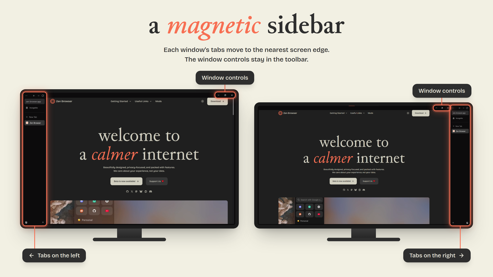
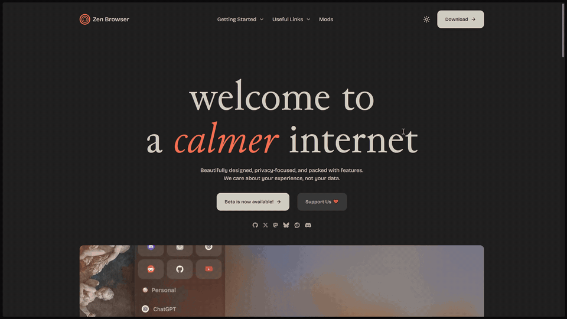

# Magnetic Sidebar for Zen Browser

Keeps the vertical tab sidebar on the screen edge nearest to the window, **per window**.

- **Multiple monitors:** a window on the left monitor gets its sidebar on the left, and a
  window on the right monitor gets it on the right.
- **Single monitor:** the same rule applies to any window that is not maximized. Snap or
  drag a window to the left half of the screen (for example with Win+←) and its sidebar
  moves to the left; move it to the right half and the sidebar follows to the right.
  A maximized window is equally far from both edges, so it keeps Zen's own setting.

The window controls (the titlebar buttons: close, minimize, maximize) are placed relative
to the sidebar. By default they stay out of it, in the main toolbar. Optionally, they can
move into the sidebar header instead. The sidebar placement can also be inverted in the
settings.

The side follows the window live. It is re-evaluated whenever the window is moved, resized,
maximized or restored. While you drag a window across the desktop, the sidebar switches
sides as soon as the window passes the center. That way the tabs always sit on the outer
edge, never in the middle between two side-by-side windows.

## Demo

### Multiple monitors

### Single monitor

## Requirements

- Zen Browser with vertical tabs (the default layout). Tested on Zen 1.22 / Windows.
- A JS-capable mod loader: [Sine](https://github.com/CosmoCreeper/Sine) or
  [fx-autoconfig](https://github.com/MrOtherGuy/fx-autoconfig). Zen's built-in Mods store
  only supports CSS and cannot run this mod.

## Installation

### Sine

1. In `about:config` set `sine.allow-unsafe-js` to `true` (required for mods that are not
   in the Sine store).
2. In Sine, install the mod from its repository URL:
   `https://github.com/D3c3453d/zen-magnetic-sidebar`
3. Restart Zen.

### fx-autoconfig

1. Copy `zen-magnetic-sidebar.uc.js` into `<profile>/chrome/JS/`
   (find the profile folder in `about:profiles`).
2. Clear the startup cache (`about:support` → "Clear startup cache…") and restart Zen.

## Settings

Available in Sine's mod settings, or in `about:config`:

| Preference | Type | Default | Effect |
|---|---|---|---|
| `magnetic_sidebar.move_tabs` | Boolean | `true` | Move the tab sidebar to the screen edge nearest to the window. |
| `magnetic_sidebar.invert_tabs` | Boolean | `false` | Invert: keep the sidebar on the side away from the nearest edge. |
| `magnetic_sidebar.move_window_controls` | Boolean | `true` | Let the mod place the window controls relative to the sidebar. |
| `magnetic_sidebar.controls_outside_sidebar` | Boolean | `true` | Keep the window controls out of the sidebar, in the main toolbar. Off moves them into the sidebar header, on the sidebar's side. |

Turning both `move_*` options off restores Zen's default behavior without a restart.

## Limitations

- Wayland does not expose window positions, so the mod cannot tell where a window is
  and leaves Zen's global setting in effect.
- macOS has not been tested.

## How it works

Zen stores the sidebar side in `zen.tabs.vertical.right-side` and the window controls side
in `zen.view.experimental-force-window-controls-left`. Both preferences are global, so the
mod never writes them. Instead, inside each window, it overrides the values Zen has cached
from those preferences and asks Zen to re-layout. `move_tabs` controls the first override
and `move_window_controls` the second.

When both screen edges are equally far away (for example, a maximized window on a single
monitor), the mod uses the value of `zen.tabs.vertical.right-side`.

## Security

The script runs with full browser privileges, like any Sine or fx-autoconfig script. It only
reads window geometry and preferences; it never writes preferences, touches page content
or makes network requests.

Two things to keep in mind:

- `sine.allow-unsafe-js` is global: it lets *every* non-store mod run JavaScript, not just
  this one. Only install mods you trust.
- A mod installed from a repository URL is updated automatically from that repository.
  If you prefer to review updates yourself, copy `zen-magnetic-sidebar.uc.js` manually
  (fx-autoconfig method) instead.

## License

[MIT](LICENSE)
